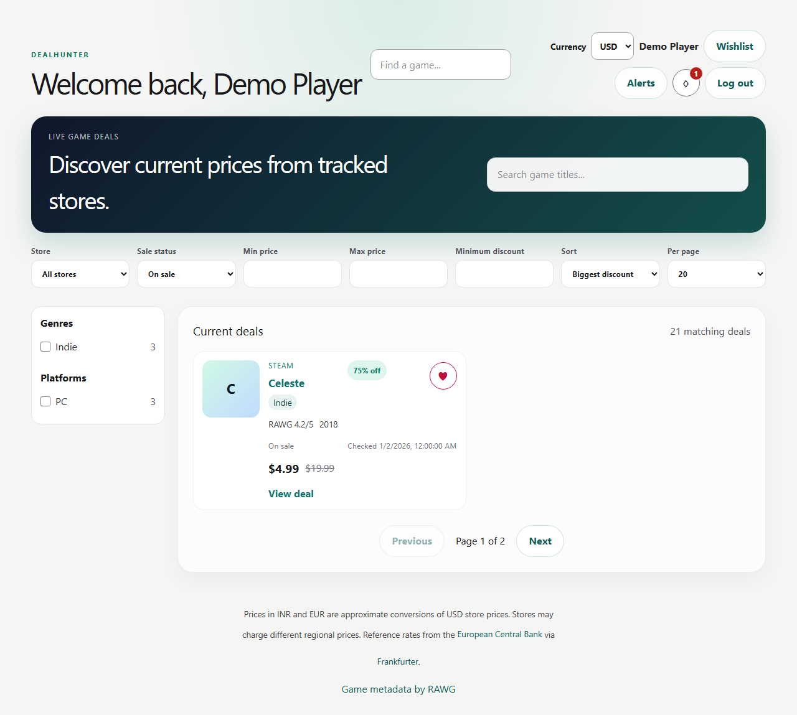
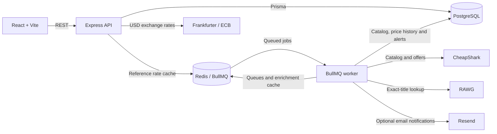

# LootDrop

LootDrop tracks PC game discounts from CheapShark, enriches matching games with RAWG metadata, and lets players compare listings, review price history, and set alerts. It preserves original store prices and uses ECB reference rates from Frankfurter to show approximate INR and EUR amounts in the browser.

## Features

- Browse active deals, free offers, best deals, and record lows. Filter by store, price, discount, genre, and platform.
- Search with keyboard autocomplete. Compare listings across stores and explore recorded prices by date range.
- Save a wishlist and configure target-price, target-discount, sale, or newly matched record-low alerts with in-app notifications and optional email.
- Switch the display currency between USD, INR, and EUR. Store listings, filters, and alert comparisons retain their original units.



See the [game detail](docs/screenshots/game-detail.png), [wishlist](docs/screenshots/wishlist.png), [alerts](docs/screenshots/alerts.png), [notifications](docs/screenshots/notifications.png), [login](docs/screenshots/login.png), and [registration](docs/screenshots/register.png) screens. Every screenshot uses mocked data.

## Architecture



The TypeScript npm workspaces use React, React Router, TanStack Query, and Recharts for the web app. Express, Prisma, PostgreSQL, Redis, and BullMQ serve the API and background jobs. Shared Zod contracts define request shapes and the OpenAPI specification. Vitest, Playwright Chromium, and Axe cover verification.

## Local setup

Use Node 24, npm, and Docker with Compose. Run from the repository root. Use an empty local database and Redis for this setup.

**Windows PowerShell**

```powershell
if (-not (Test-Path .env)) { Copy-Item apps/api/.env.example .env }
```

**Linux**

```sh
cp -n apps/api/.env.example .env
```

Set `JWT_ACCESS_SECRET` in the ignored root `.env` to a privately generated random value. Configure `DATABASE_URL`, `DIRECT_URL`, and `REDIS_URL` for the local services. Use the same local Postgres settings for the Compose service and the API. Set `DEMO_USER_PASSWORD` if you will run the demo seed.

Run these commands against that **local database** to install dependencies, start the services, and initialize the schema and seed catalog lookups. On Windows, use `npm.cmd` if PowerShell blocks the `npm` shim.

```text
docker compose up -d postgres redis
npm ci
npm run db:deploy --workspace=@lootdrop/api
npm run db:seed --workspace=@lootdrop/api
npm run build --workspace=@lootdrop/contracts
```

In separate terminals run `npm run dev:api`, `npm run dev:web`, and `npm run worker:deals --workspace=@lootdrop/api`. To populate live listings immediately, run `npm run sync:deals --workspace=@lootdrop/api`. Open the [web app](http://localhost:5173) or [API explorer](http://localhost:4000/docs). Set `RAWG_API_KEY` to enable enrichment. [Local provider operations and guarded checks](docs/pricing-operations.md)

## How to demo this project

Run the seed on a local database and log in as `demo@lootdrop.local` with the password you set through `DEMO_USER_PASSWORD` in the seed settings. Open a deal, switch to INR, review its price chart, save it to the wishlist, and create a price alert. For an offline preview with predictable data, use the screenshots or mocked browser suite.

## Account email

- Set `EMAIL_PROVIDER=resend`, `RESEND_API_KEY`, and `EMAIL_FROM` with a Resend-verified sending domain to deliver verification and reset emails. Keep click tracking disabled for these emails. Set `WEB_ORIGIN` to the exact frontend origin used to open links.
- After the account-links migration is applied, new registrations receive a verification email. Existing users can request one from the catalog. Verification requires signing in to the matching account. Unverified users retain catalog access.
- The login page offers **Forgot your password?**. Reset links expire after 30 minutes and verification links after 24 hours. Links can be used once. Resetting the password revokes refresh sessions and prompts the user to sign in again. Previously issued access tokens expire within 15 minutes.
- With the default `log` provider, the app does not send account emails. Automated tests use mock delivery.

## Environment variables

| Variable                                                                                                               | Requirement or default                                                                                              |
| ---------------------------------------------------------------------------------------------------------------------- | ------------------------------------------------------------------------------------------------------------------- |
| `NODE_ENV`                                                                                                             | `development`, `test`, or `production`. Defaults to development.                                                    |
| `DATABASE_URL`, `REDIS_URL`                                                                                            | Required at runtime. Use the pooled PostgreSQL endpoint for the app when using Neon.                                |
| `DIRECT_URL`                                                                                                           | Required in production and by Prisma migration commands.                                                            |
| `WEB_ORIGIN`                                                                                                           | Exact HTTPS browser origin required in production. Development defaults to localhost port 5173.                     |
| `API_PORT`, `LOG_LEVEL`, `TRUST_PROXY`                                                                                 | Default to `4000`, `info`, and `0`. Set proxy hops only for a controlled ingress.                                   |
| `JWT_ACCESS_SECRET`, `JWT_ISSUER`                                                                                      | Signing secret is required. Generate at least 32 random bytes for production. Issuer defaults to `lootdrop-api`.    |
| `AUTH_COOKIE_SECURE`, `AUTH_COOKIE_SAME_SITE`                                                                          | Secure defaults on and is required in production. SameSite defaults to `lax`.                                       |
| `AUTH_RATE_LIMIT_WINDOW_MINUTES`, `AUTH_RATE_LIMIT_MAX`                                                                | Default to `15` minutes and `10` requests.                                                                          |
| `CHEAPSHARK_USER_AGENT`, `CHEAPSHARK_MAX_PAGES`, `DEAL_SYNC_INTERVAL_MINUTES`                                          | Provider identity, maximum pages per sync, and interval. Defaults to `LootDrop/0.1.0`, `2` pages, and `45` minutes. |
| `RAWG_API_KEY`, `RAWG_MAX_REQUESTS_PER_RUN`, `RAWG_ENRICH_BATCH_SIZE`, `ENRICH_INTERVAL_MINUTES`                       | Optional key. Request budget, candidate batch size, and interval default to `30`, `15`, and `60` minutes.           |
| `EMAIL_PROVIDER`, `RESEND_API_KEY`, `EMAIL_FROM`                                                                       | Defaults to the masked `log` provider. Both Resend settings are required when using `resend`.                       |
| `VITE_API_BASE_URL`, `VITE_API_PROXY_TARGET`                                                                           | Browser API path defaults to `/api/v1`. Optional Vite dev-proxy target defaults to localhost port 4000.             |
| `POSTGRES_USER`, `POSTGRES_PASSWORD`, `POSTGRES_DB`, `POSTGRES_PORT`, `REDIS_PORT`                                     | Local Docker Compose settings.                                                                                      |
| `DEMO_USER_PASSWORD`                                                                                                   | Required only for the demo seed. Keep it in the ignored root `.env`.                                                |
| `DIRECT_URL_PHASE4_TEST`, `DATABASE_URL_PHASE4_TEST`                                                                   | Direct and pooled endpoint for the guarded Phase 4 child branch.                                                    |
| `DIRECT_URL_PHASE5_TEST`, `DATABASE_URL_PHASE5_TEST`                                                                   | Direct and pooled endpoint for the guarded Phase 5 child branch.                                                    |
| `DIRECT_URL_PHASE6_TEST`, `DATABASE_URL_PHASE6_TEST`                                                                   | Direct and pooled endpoint for the guarded Phase 6 child branch.                                                    |
| `LOOTDROP_QUEUE_TEST_PORT`                                                                                             | Optional loopback Redis port for the queue regression tests. CI supplies a disposable Redis service.                |
| `BULLMQ_PREFIX`, `DISABLE_REPEATABLE_SCHEDULES`                                                                        | Scoped by the branch guards. The regular worker uses BullMQ’s `bull` prefix and registers schedules.                |
| `PHASE4_TEST_GUARD`, `PHASE5_GUARD_TARGET`, `PHASE5_GUARD_FINGERPRINT`, `PHASE6_TEST_GUARD`, `PHASE6_TEST_FINGERPRINT` | Internal branch guard markers.                                                                                      |

## Scripts and testing

| Command                                                                 | Use                                                                                         |
| ----------------------------------------------------------------------- | ------------------------------------------------------------------------------------------- |
| `npm run dev:api`, `npm run dev:web`                                    | Start the API and web app for development.                                                  |
| `npm run build`                                                         | Build contracts, the API and worker, and the web app.                                       |
| `npm run start`, `npm run start:worker`                                 | Run the built API and worker with Node.                                                     |
| `npm run format:check`, `npm run lint`, `npm run typecheck`, `npm test` | Check formatting, lint, TypeScript, and unit and integration tests.                         |
| `npx playwright install chromium`                                       | Install Chromium for local browser verification.                                            |
| `npm run test:e2e`                                                      | Run real-browser UI flows, Axe, keyboard checks, and responsive captures with a mocked API. |
| `npm run screenshots`                                                   | Regenerate the seven portfolio images under `docs/screenshots`.                             |
| `npm run test:e2e:smoke`                                                | Run the full-stack smoke test against the guarded Phase 6 child branch.                     |
| `npm run enrich:once -- --limit 10`                                     | Run bounded RAWG enrichment. Use the branch guard when targeting a shared test database.    |

The smoke test requires `DIRECT_URL_PHASE6_TEST` and `DATABASE_URL_PHASE6_TEST`. The [guard](scripts/phase6-test-guard.mjs) scopes the child-branch connection to the test process, uses a unique queue prefix, and disables repeatable schedules. The smoke test removes its throwaway account and checks that it is gone. GitHub Actions runs the standard quality gate. The mocked Chromium job can be enabled through the workflow’s manual `run_e2e` input.

## API and data model

Open Swagger UI at `/docs` or fetch the specification from `/docs/openapi.json`. Public `/api/v1` routes cover deals, stores, games, history, genres, platforms, and exchange rates. Auth routes provide registration and sessions. Account routes manage preferences, wishlist entries, alerts, and notifications. `/health` checks liveness and `/health/ready` checks PostgreSQL and Redis.

- `Game` joins genres and platforms and links to each store’s `StoreListing`.
- `PriceSnapshot` records observations per listing in its original currency. `ScrapeRun` records ingestion metadata.
- `User` owns hashed `RefreshToken` records, `Wishlist` entries, `PriceAlert` rules, and `Notification` events.

## Design decisions

- **Provider APIs.** CheapShark serves prices, RAWG serves attributed game metadata, and Frankfurter serves exchange rates.
- **Conservative metadata.** Enrichment accepts one normalized exact-title match. It preserves existing data and caches unresolved candidates for seven days.
- **Append-only price history.** Listings expose current prices. Snapshots retain historical observations for charts and record-low alerts.
- **Display-only conversion.** The browser marks estimates with `≈`. Stored prices, alert evaluation, filters, and sorting use original amounts.
- **Session handling.** The browser keeps short-lived access tokens in memory. Refresh tokens are stored in an HttpOnly cookie and hashed in PostgreSQL. Refresh and logout check the browser origin.
- **Redis and queues.** BullMQ schedules work apart from request handling. Redis also holds temporary FX data and the RAWG negative cache. PostgreSQL owns durable application state.

## Limitations and roadmap

See the [known issues](docs/known-issues.md), [security policy](SECURITY.md), [security review](docs/phase-6-security-review.md), and [performance measurements](docs/phase-6-performance.md). Price conversions are estimates and games without an unambiguous metadata match can remain uncategorized. Phase 7 covers deployment, hosted readiness checks, and observing real traffic and Redis usage.

## License

LootDrop is available under the [MIT License](LICENSE).
